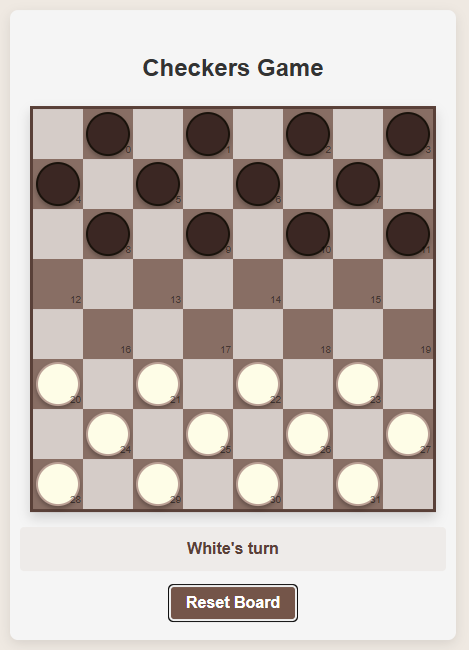
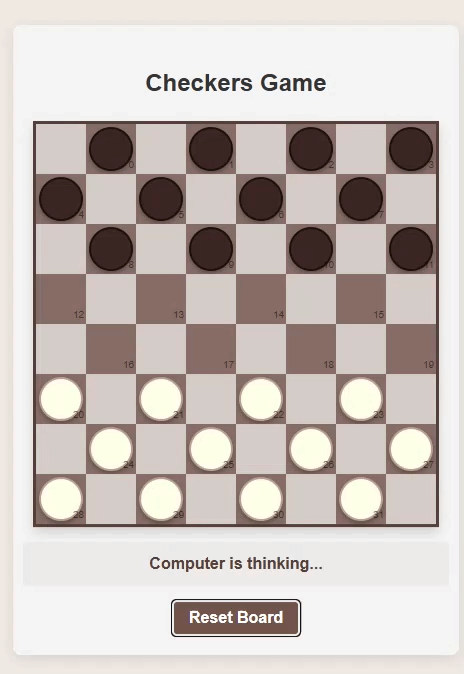
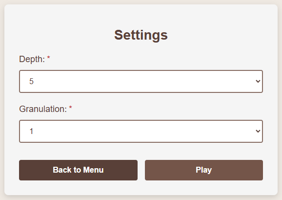

# Distributed Checkers

A browser checkers game (8x8) against a computer opponent. The AI searches the game tree with minimax and alpha-beta pruning, and the search is split into independent jobs that are spread over several worker processes (gRPC), so move calculation can be distributed across machines.

**Stack:** C# / .NET 8, ASP.NET Core, gRPC, WebSocket, React, Vite.
Group project for the distributed systems course (PSR).

<p align="center">
  
  
</p>

## How it works

```
Browser (React)  --WebSocket-->  Server  --gRPC-->  Worker(s)
                                 game + AI           search sub-trees
```

1. The client shows the board and sends the player's moves.
2. The server keeps one game per connection. To find the computer's move it expands the first few plies of the search tree and turns each resulting node into a job.
3. Each worker runs minimax with alpha-beta pruning on its job and returns the score.
4. The server merges the scores and picks the best move.
5. If a worker is slow or down, its jobs go to the other workers or are computed locally.

Rules, move generation and the search live in one shared library used by both the server and the workers. The game state is kept in memory, so no database is needed.

## Features

- Play against the computer, or watch computer vs computer.
- Adjustable search depth and granulation (how many plies the server expands itself before splitting the search into jobs; more plies means more, smaller jobs).
- Mandatory captures, multi-captures, flying kings, draws by repetition.
- Any number of workers, configured by address.
- Per-move metrics written to a CSV file.

<p align="center">
  
</p>

## Run it

Requirements: .NET SDK 8+ and Node.js 20+.

```
./scripts/run-all.ps1        # 2 workers + server + client (Linux/macOS: ./scripts/run-all.sh)
```

Then open http://localhost:5173. Without workers (`-Workers 0`) the server searches on the local CPU.

Tests: `dotnet test Checkers.sln`

## Project structure

| Path | Contents |
|---|---|
| `src/Checkers.Core` | Rules, search, game state |
| `src/Checkers.Contracts` | gRPC contract |
| `src/Checkers.Server` | WebSocket API, worker pool |
| `src/Checkers.Worker` | gRPC worker |
| `client/` | React UI |
| `tests/` | Unit and integration tests |
| `tools/Checkers.Benchmark` | Local vs distributed timing |

## Results

Measured with `tools/Checkers.Benchmark` on one 12-core Windows machine, two workers on localhost, granulation 3,
3 mid-game positions, workers and benchmark built in Release. Local and distributed search chose the same move every time.

| Depth | Local | 2 workers | Speed-up |
|---|---|---|---|
| 9 | 610 ms | 2092 ms | 0.29x |
| 11 | 3768 ms | 3533 ms | 1.07x |

At low depth the cost of sending jobs outweighs the gain. At depth 11 the distributed search is slightly faster even
though everything runs on one machine. Separate machines were not measured.

## Known limitations

- Measured only on one machine with workers on localhost, where they share the same CPU cores with the local search.
  Running on separate machines was not measured.
- The evaluation function is simple, so the AI is not strong.
- Workers are configured statically and the gRPC port has no authentication, so it is meant for a trusted network.

<details>
<summary>Game rules</summary>

Checkers on an 8x8 board (not the 10x10 international variant).

- White moves first, players alternate.
- Men move and capture diagonally forward only.
- Captures are mandatory (any capture, there is no "must take the most" rule). A piece keeps jumping until it cannot, and may change direction between jumps.
- A man that reaches the opponent's last row becomes a king and its turn ends. Kings move and capture any distance diagonally, in all four directions.
- A player who has no pieces or no legal move loses.
- The game is a draw on threefold repetition or after 80 plies without a capture or a man move.

</details>

<details>
<summary>Position evaluation</summary>

The score is always from White's point of view (positive favours White). For every piece: man 100, king 300,
+3 on the board edge. Men also get +5 per row advanced and +8 on their own back row. A lost game scores far above any
material value, and a faster win scores higher.

</details>

<details>
<summary>Job sent to a worker</summary>

The board (32 bytes, one per dark square), the side to move and the remaining search depth.
The worker answers with the score, the number of nodes searched and its compute time.

</details>
