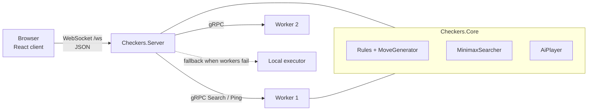

# Architecture

## Components

`Checkers.Core` is shared by the server and the workers, so both sides apply identical rules and evaluation.
That is what makes distributed and local results interchangeable (tests assert equality).

## How a computer move is found

1. `AiPlayer` generates the legal root moves. With a single legal move it returns at once.
2. The tree is expanded `granulation` plies deep on the coordinator. Each leaf becomes a `SearchJob`
   (board, side to move, remaining depth).
3. An `ISearchExecutor` runs the jobs: `LocalSearchExecutor` (parallel on local cores) or
   `DistributedSearchExecutor` (gRPC workers, local fallback).
4. Worker side: `MinimaxSearcher` runs alpha-beta on the position and returns the score, node count and compute time.
5. Scores are folded back up the expanded tree (max for White, min for Black); the best root move wins.
   Equal moves are broken randomly in live games so computer-vs-computer games vary.

All scores are from White's point of view. A side without legal moves loses, and faster wins score higher.

Granulation trades load balance against traffic: 1 gives one job per root move (few, large jobs), higher values give
more, smaller jobs that spread better over many workers.

## Distribution and failure handling

`DistributedSearchExecutor` uses pull-based scheduling. Every worker runs `ConcurrencyPerWorker` loops that take the
next job from a shared queue as soon as they finish the previous one, so faster machines automatically do more work.

- A transport failure or missed deadline marks that worker as failed for `WorkerCooldownSeconds` and puts the job back
  in the queue for the others.
- Jobs that no worker could finish are computed locally, so a move never fails because of the network.
- Cancellation (reset, new settings, disconnect) propagates to in-flight gRPC calls and to the search loop.
- The worker limits concurrent searches to its core count and rejects malformed requests with `InvalidArgument`.

## Wire formats

gRPC (`src/Checkers.Contracts/Protos/search.proto`): `SearchRequest{board: 32 bytes, white_to_move, depth, task_id}` to
`SearchResponse{score, nodes, compute_ms, worker}`, plus `Ping`. The board is one byte per dark square in row-major
order (0 empty, 1 white man, 2 white king, 3 black man, 4 black king).

WebSocket JSON (client to server): `{"type":"settings","depth":5,"granulation":2,"isPerformanceTest":false,"isPlayerMode":true}`,
`{"type":"move","FromRow":5,"FromCol":2,"ToRow":4,"ToCol":3}`, `{"type":"reset"}`.
A multi-capture is sent one jump at a time with the same piece.

Server to client: the game state `{Success, Board[64], IsWhiteTurn, GameOver, Winner, DrawReason, CurrentPlayer,
MustContinueCapture, LastAiMove}` or `{"error": "..."}`. An error never changes the game.

## Sessions

Each WebSocket connection owns a `CheckersGame`. The computer's turns run in a background task and are guarded by a
generation counter, so a reset or new settings cancels an in-progress search and a late result is discarded.
Closing the page cancels everything for that game.

## Metrics

Every computer move appends a row to `logs/search_metrics.csv`
(`timestamp_utc,game_id,side,depth,granulation,jobs,nodes,elapsed_ms,score,forced,workers`).
`GET /api/status` reports each worker's reachability, cores, completed and failed jobs, and the remote/fallback job totals.
